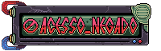
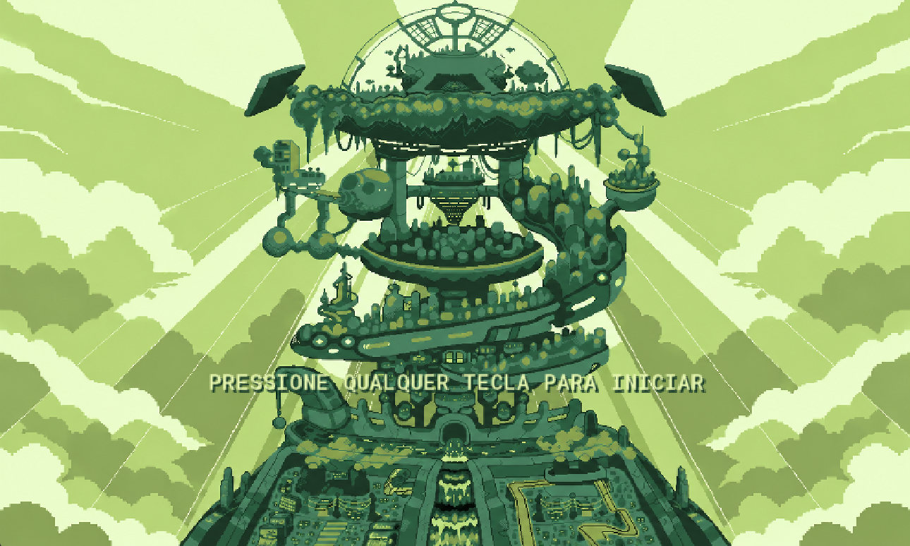
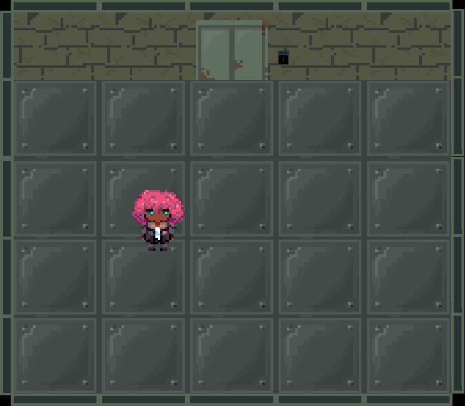
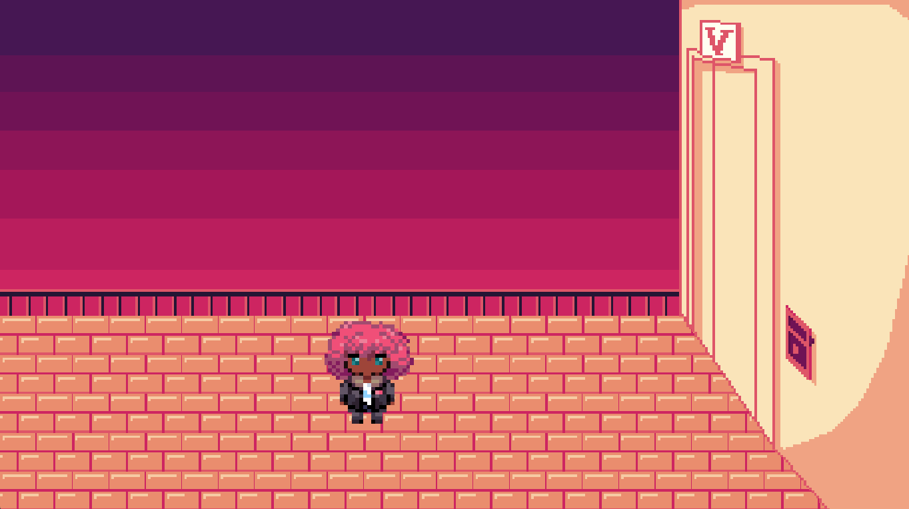
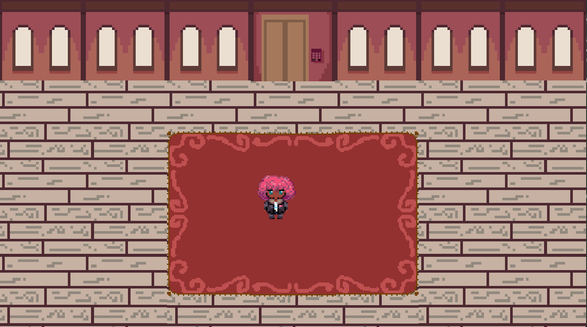
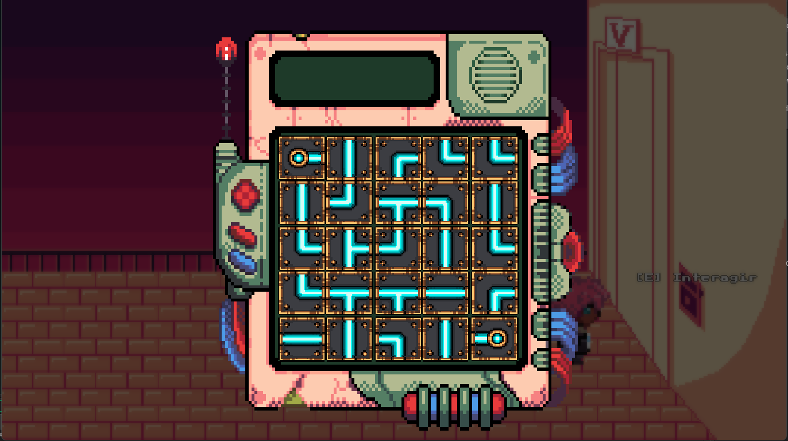

<h1 align="center">Acesso Negado</h1>

 

  

 

---

## Navegação

- [Sobre a Game Jam](#sobre-a-game-jam)
- [Sobre o jogo](#sobre-o-jogo)
- [Mecânicas](#mecânicas)
- [Instalação](#instalação)
- [Nossa equipe](#nossa-equipe)
- [Galeria](#galeria)
- [Créditos](#créditos)

 

## Sobre a Game Jam

O jogo foi desenvolvido durante uma Game Jam com o tema **"Cidade Inclusiva e Acessível"**.
O desafio consiste em desenvolver um jogo que aborde questões relacionadas à acessibilidade, inclusão digital, participação cidadã e construção de uma sociedade mais inclusiva.

 

## Sobre o jogo

Acesso Negado é um jogo de aventura narrativa ambientado em uma sociedade distópica, onde as pessoas são divididas em camadas de acordo com sua produtividade.

A história acompanha Rayssa, uma jovem programadora com deficiência visual que, após ser negligenciada pelo governo, é enviada para uma das camadas inferiores. Com a ajuda de outros personagens, ela busca desafiar o sistema, superar obstáculos e lutar pelos direitos daqueles que foram excluídos.

 

## Instalação

### 1. Baixar o projeto

Acesse o repositório no GitHub e selecione **Code → Download ZIP**, ou clone o repositório utilizando o Git.

### 2. Abrir no GameMaker

Após extrair os arquivos:

1. Abra o GameMaker.
2. Selecione a opção de abrir um projeto existente.
3. Localize o arquivo `.yyp` do jogo.
4. Aguarde o carregamento do projeto.

### 3. Executar o jogo

Pressione **F5** para iniciar o jogo pelo GameMaker.

 

## Nossa equipe

Projeto desenvolvido por:

- Mell Ruiz Lopes
- Henrique Satoshi Kanazawa
- Igor Silva Santos
- Rafael Kenji Obara

 

## Galeria

